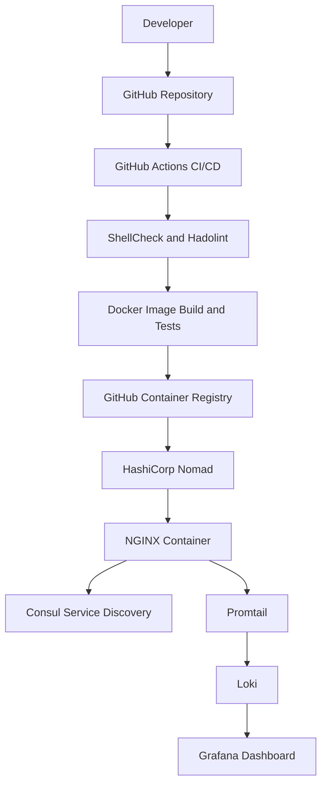

# DevOps Intern Final Assessment

**Author:** Onome Vera Oviero  
**Project:** DevOps Intern Final Assessment  
**Date:** November 17, 2026  
**Repository:** `devops-intern-final`

[](https://github.com/OnomeVera/devops-intern-final/actions/workflows/ci.yml)

## Project Overview

This project demonstrates an end-to-end DevOps workflow for deploying and monitoring a containerised NGINX web application.

It brings together Linux shell scripting, Git and GitHub, Docker, GitHub Actions, GitHub Container Registry (GHCR), HashiCorp Nomad, Consul, Loki, Promtail, and Grafana.

The project focuses on automation, container security, continuous integration, service discovery, deployment health checks, and centralised log monitoring.

## Architecture



## Technology Stack

| Technology | Purpose |
|---|---|
| Linux / Bash | Automation and system administration |
| Git / GitHub | Version control and collaboration |
| ShellCheck | Shell script linting |
| Docker | Application containerisation |
| NGINX | Web server |
| Hadolint | Dockerfile linting |
| GitHub Actions | CI/CD automation |
| GHCR | Container image registry |
| HashiCorp Nomad | Container orchestration |
| Consul | Service discovery and health checks |
| Loki | Log aggregation |
| Promtail | Log collection |
| Grafana | Log visualisation and monitoring |

## Repository Structure

```text
devops-intern-final/
│
├── app/
│   ├── Dockerfile
│   ├── nginx.conf
│   └── index.html
│
├── scripts/
│   ├── sysinfo.sh
│   └── healthcheck.sh
│
├── nomad/
│   └── nginx-app.nomad.hcl
│
├── monitoring/
│   ├── docker-compose.yaml
│   ├── loki-config.yaml
│   ├── promtail-config.yaml
│   └── loki_setup.md
│
├── .github/
│   └── workflows/
│       └── ci.yml
│
├── docs/
│   └── screenshots/
│
├── .gitignore
└── README.md
```

## 1. Git and GitHub Version Control

The project is maintained in Git and hosted in a public GitHub repository.

The workflow includes:

- Incremental commits using conventional commit messages.
- Feature branch development.
- Pull request creation and self-review.
- Merging approved changes into `main`.
- Version tagging using `v1.0.0`.

### Useful Git commands

```bash
git status
git branch
git log --oneline
git tag
git checkout main
git pull origin main
```

To inspect the release tag:

```bash
git show v1.0.0
```

## 2. Linux Shell Automation

Two Bash scripts are included in the `scripts/` directory.

### System information script

File: `scripts/sysinfo.sh`

The script reports:

- Current username and effective user ID.
- Hostname and kernel information.
- Current date.
- Disk usage.
- Memory information.
- Docker daemon status.

Run:

```bash
./scripts/sysinfo.sh
```

### Application health-check script

File: `scripts/healthcheck.sh`

The script checks whether the application responds with HTTP status code `200`.

It accepts a URL as an argument and defaults to:

```text
http://localhost:8080
```

Run:

```bash
./scripts/healthcheck.sh
```

Or provide a URL:

```bash
./scripts/healthcheck.sh http://localhost:8080
```

A successful check returns a success message. A failed check returns a non-zero exit code.

### Shell script validation

```bash
shellcheck scripts/*.sh
```

## 3. Docker Containerisation

The application uses NGINX to serve a custom static website.

The Dockerfile is located in:

```text
app/Dockerfile
```

The container configuration includes:

- Pinned NGINX Alpine base image.
- Custom NGINX configuration.
- Non-root runtime user.
- Port `8080`.
- Docker health check.
- Build SHA metadata through a build argument.
- Static application content.

### Build the image

From the repository root:

```bash
docker build \
  --build-arg BUILD_SHA="$(git rev-parse HEAD)" \
  -t devops-intern-final:assessment-v1 \
  ./app
```

### Run the container

```bash
docker run -d \
  --name devops-nginx \
  -p 8080:8080 \
  devops-intern-final:assessment-v1
```

### Verify the application

```bash
curl -i http://localhost:8080/
```

Check the health endpoint:

```bash
curl -i http://localhost:8080/healthz
```

**Verified health-check result:**

```text
HTTP/1.1 200 OK
Server: nginx
Content-Type: text/plain
Content-Length: 8

healthy
```

This confirms that the NGINX health endpoint returned HTTP `200 OK`.

### Inspect the Docker image

```bash
docker images devops-intern-final
```

The observed image information was:

| Image | Image ID | Disk usage | Content size |
|---|---|---:|---:|
| devops-intern-final:assessment-v1 | d7b97efda541 | 73.7 MB | 21 MB |

**Image-size note:** Docker reported 73.7 MB disk usage and 21 MB content size. These are different measurements. The assessment's under-60-MB requirement should be checked against the exact size measurement expected by the reviewer.

For further inspection:

```bash
docker image inspect devops-intern-final:assessment-v1 \
  --format='Size: {{.Size}} bytes'

docker history devops-intern-final:assessment-v1
```

## 4. CI/CD with GitHub Actions

The CI/CD workflow is located at:

```text
.github/workflows/ci.yml
```

The pipeline is configured to run on pushes and pull requests targeting `main`.

The workflow covers:

1. Shell script linting with ShellCheck.
2. Dockerfile linting with Hadolint.
3. Docker image building.
4. Container startup and application health testing.
5. Publishing the container image to GitHub Container Registry on pushes to `main`.

The image is built with the Git commit SHA and is intended to be published with both a commit-specific tag and a `latest` tag.

### View workflow runs

Open the GitHub Actions tab in the repository:

```text
https://github.com/OnomeVera/devops-intern-final/actions
```

### Container registry

The intended registry is:

```text
ghcr.io
```

The workflow uses GitHub-provided authentication and permissions to publish images.

## 5. Nomad Deployment and Consul Service Discovery

The Nomad job specification is located at:

```text
nomad/nginx-app.nomad.hcl
```

The deployment uses the Docker driver to run the NGINX application.

The job configuration includes:

- Service-type Nomad job.
- One task group and one Docker task.
- Configurable container image tag.
- CPU allocation of 100 MHz.
- Memory allocation of 64 MB.
- Dynamic HTTP host port mapped to container port `8080`.
- Consul service registration.
- HTTP health checks against `/healthz`.
- Rolling deployment configuration.
- Restart and rescheduling policies.
- Automatic deployment rollback.

### Validate the Nomad job

```bash
nomad job validate nomad/nginx-app.nomad.hcl
```

### Plan the deployment

```bash
nomad job plan nomad/nginx-app.nomad.hcl
```

### Run the job

```bash
nomad job run nomad/nginx-app.nomad.hcl
```

### Check deployment status

```bash
nomad job status nginx-app
```

**Verified deployment result:**

```text
ID          = nginx-app
Type        = service
Status      = running

Summary
Task Group  Queued  Starting  Running  Failed  Complete
web         0       0         1        0       1

Latest Deployment
Status      = successful
Description = Deployment completed successfully

Deployed
Task Group  Desired  Placed  Healthy  Unhealthy
web         1        1       1        0

Allocations
ID        Task Group  Desired  Status
cb88e463  web         run      running
```

The output confirms one running allocation, one healthy allocation, no unhealthy allocations, and a successful deployment.

### Inspect the allocation

```bash
nomad alloc status cb88e463
```

To inspect application logs, first identify the task name in the allocation details, then run:

```bash
nomad alloc logs cb88e463 <task-name>
```

### Verify Consul registration and health

List registered services:

```bash
consul catalog services
```

Inspect the registered service health:

```bash
curl -s http://localhost:8500/v1/health/service/nginx-app
```

If `jq` is installed, display the check status:

```bash
curl -s http://localhost:8500/v1/health/service/nginx-app \
  | jq '.[].Checks[] | {CheckID, Status, Output}'
```

A passing health check should report:

```text
"Status": "passing"
```

## 6. Centralised Logging and Monitoring

The monitoring stack uses Docker Compose to run:

- Loki for log storage and querying.
- Promtail for log collection.
- Grafana for log visualisation.

Configuration files are stored in:

```text
monitoring/
```

### Start the monitoring stack

From the repository root:

```bash
docker compose -f monitoring/docker-compose.yaml up -d
```

### Check container status

```bash
docker compose -f monitoring/docker-compose.yaml ps
```

**Verified container status:**

| Service | Image | Status | Port |
|---|---|---|---|
| Grafana | grafana/grafana:11.5.2 | Running | 3000 |
| Loki | grafana/loki:3.5.1 | Running | 3100 |
| Promtail | grafana/promtail:3.5.1 | Running | — |

All three monitoring containers were observed running.

### Check Loki readiness

```bash
curl http://localhost:3100/ready
```

The expected response is:

```text
ready
```

### Open Grafana

Visit:

```text
http://localhost:3000
```

Configure Loki as a Grafana data source using:

```text
http://loki:3100
```

Use Grafana Explore to inspect the collected application logs.

### Example LogQL queries

All NGINX logs:

```logql
{job="nginx"}
```

Filter access logs:

```logql
{job="nginx"} |= "GET"
```

Find 404 responses:

```logql
{job="nginx"} |= "404"
```

The exact labels depend on the Promtail configuration and the labels successfully attached to ingested log streams.

### Monitoring documentation

Further setup instructions, validation results, queries, and troubleshooting notes are maintained in:

```text
monitoring/loki_setup.md
```

## 7. Local Development Quick Start

### Prerequisites

The following tools were available in the development environment:

| Tool | Verified version |
|---|---|
| Docker | 29.9.2 |
| Docker Compose | v5.6.1 |
| Nomad | v2.1.1 |
| Consul | v2.1.0 |
| ShellCheck | 0.9.0 |
| Git | 2.43.0 |

NGINX, Nomad, and monitoring services also require their respective configurations and services to be available.

### Clone the repository

```bash
git clone https://github.com/OnomeVera/devops-intern-final.git
cd devops-intern-final
```

### Run the system information script

```bash
chmod +x scripts/*.sh
./scripts/sysinfo.sh
```

### Build and run the application

```bash
docker build -t devops-intern-final:assessment-v1 ./app
docker run -d --name devops-nginx -p 8080:8080 devops-intern-final:assessment-v1
```

### Test the application

```bash
curl -i http://localhost:8080/healthz
```

### Start monitoring

```bash
docker compose -f monitoring/docker-compose.yaml up -d
```

### Check monitoring services

```bash
docker compose -f monitoring/docker-compose.yaml ps
```

### Validate the Nomad job

```bash
nomad job validate nomad/nginx-app.nomad.hcl
```

## 8. Troubleshooting and Lessons Learned

### Issue 1: Incorrect Consul CLI command

**Problem:** Running:

```bash
consul health checks nginx-app
```

returned the Consul command usage information because `health checks` is not a valid Consul CLI command.

**Resolution:** Use the Consul HTTP API to inspect service health:

```bash
curl -s http://localhost:8500/v1/health/service/nginx-app
```

This provided the correct method for checking registered service health.

### Issue 2: Docker image size reporting

**Problem:** Docker displayed different values for disk usage and content size.

**Resolution:** Inspect the image using:

```bash
docker image inspect devops-intern-final:assessment-v1 \
  --format='Size: {{.Size}} bytes'

docker history devops-intern-final:assessment-v1
```

This helps distinguish image size from the disk usage reported by Docker Desktop.


## 9. Screenshots and Evidence

Project evidence is stored in:

```text
docs/screenshots/
```

Recommended evidence to include:

| Screenshot | Evidence |
|---|---|
| `01-github-repository.png` | Public GitHub repository |
| `02-git-commits.png` | Incremental commit history |
| `03-feature-branch.png` | Feature branch |
| `04-merged-pull-request.png` | Reviewed and merged pull request |
| `05-release-tag.png` | `v1.0.0` release tag |
| `06-sysinfo-output.png` | System information script |
| `07-shellcheck.png` | ShellCheck validation |
| `08-healthcheck-script.png` | Application health-check script |
| `09-docker-build.png` | Docker image build |
| `10-docker-container.png` | Running NGINX container |
| `11-nginx-health.png` | HTTP 200 health endpoint |
| `12-docker-image-size.png` | Image size inspection |
| `13-github-actions.png` | CI/CD pipeline |
| `14-ghcr-image.png` | Published GHCR image |
| `15-nomad-validation.png` | Nomad job validation |
| `16-nomad-deployment.png` | Successful Nomad deployment |
| `17-nomad-allocation.png` | Healthy allocation |
| `18-consul-health.png` | Passing Consul health check |
| `19-monitoring-containers.png` | Loki, Promtail, and Grafana running |
| `20-grafana-explore.png` | Application logs in Grafana |

Only include screenshots of results that were actually achieved.

## 10. Known Limitations and Future Improvements

Potential improvements include:

- Add TLS termination and HTTPS support.
- Add stronger container image security scanning.
- Add automated deployment to a production Nomad cluster.
- Introduce alerting for application failures.
- Add dashboard panels for request rates and HTTP error rates.
- Implement automated backup and retention policies for Loki.
- Improve deployment secrets management.

## Conclusion

This project demonstrates the integration of essential DevOps practices across source control, shell automation, containerisation, CI/CD, orchestration, service discovery, and monitoring.

It provides a practical example of how a web application can be built, tested, deployed, monitored, and maintained using modern DevOps tools.

---

**Project:** DevOps Intern Final Assessment  
**Author:** Onome Vera Oviero  
**Repository:** `https://github.com/OnomeVera/devops-intern-final`